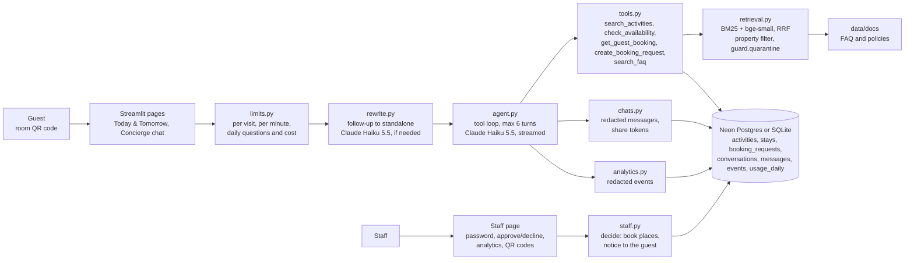
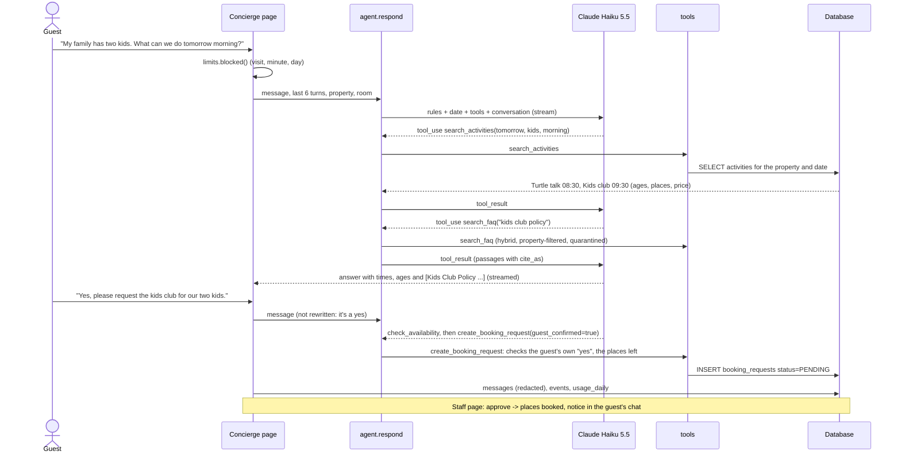

# Architecture

## System

## A message, start to finish

## Components

| Module | Job |
|---|---|
| `app.py` | Navigation, the shared-conversation view |
| `pages/schedule.py` | Today & Tomorrow with filters, "starting in the next hour", finished sessions, into the chat |
| `pages/concierge.py` | Chat: streaming, steps, sources, history, share link, staff updates (refreshes every 20 s) |
| `pages/staff.py` | Sign-in, pending requests, analytics, room QR codes |
| `pages/about.py` | What it is, how to try it, the latest eval reports |
| `src/concierge/agent.py` | The tool-use loop and the system prompt |
| `src/concierge/tools.py` | The five tools, their schemas, the consent check |
| `src/concierge/retrieval.py` | Passages from `data/docs`, BM25 + embeddings + RRF, quarantine |
| `src/concierge/rewrite.py` | Follow-up → standalone question |
| `src/concierge/db.py` | Tables, engine (pool, pre-ping), `connect()` with retries |
| `src/concierge/seed.py` | Weekly templates → 14-day schedule; demo stays re-dated around today |
| `src/concierge/chats.py` | Conversations, redacted messages, share tokens |
| `src/concierge/staff.py` | Password check, approve/decline, the guest notice |
| `src/concierge/analytics.py` | Events and the Staff page's queries |
| `src/concierge/limits.py` | Session and daily limits (daily counters in the database) |
| `src/concierge/qr.py` | Room QR codes (segno) |
| `eval/run_eval.py` | Agent eval (76 cases), retrieval eval (36 questions), re-scoring |

## Scaling path

1. Connection pooling through Neon's pooler endpoint, and more Streamlit replicas behind it; limits are already in
   the database, so they hold across replicas.
2. A `hotel_group_id` on every table and row-level security, for more than one hotel group.
3. Embeddings computed once at build time and stored (pgvector) instead of at every start.
4. The tools behind the stage 7 MCP server, so staff tools and guest tools share one role-checked layer.
